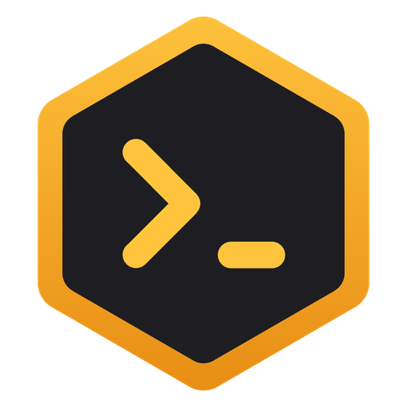
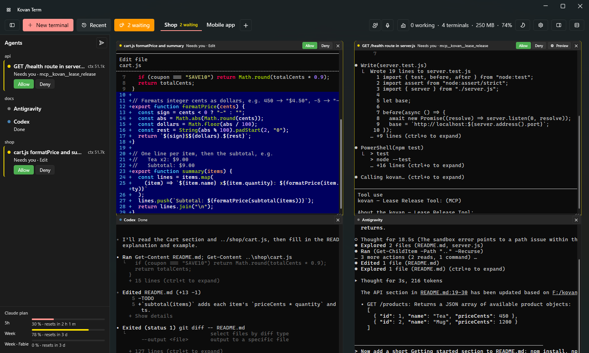
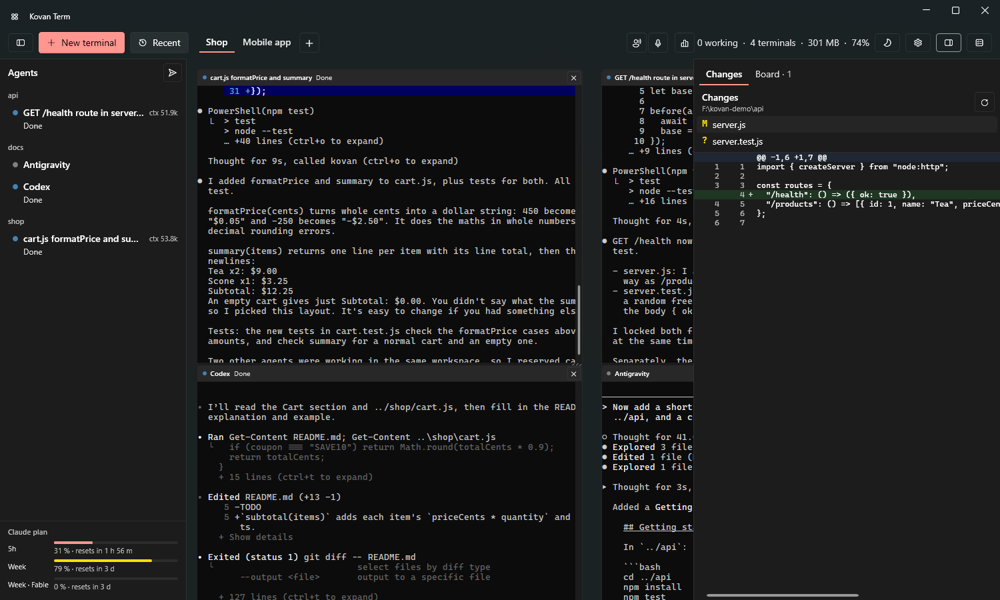
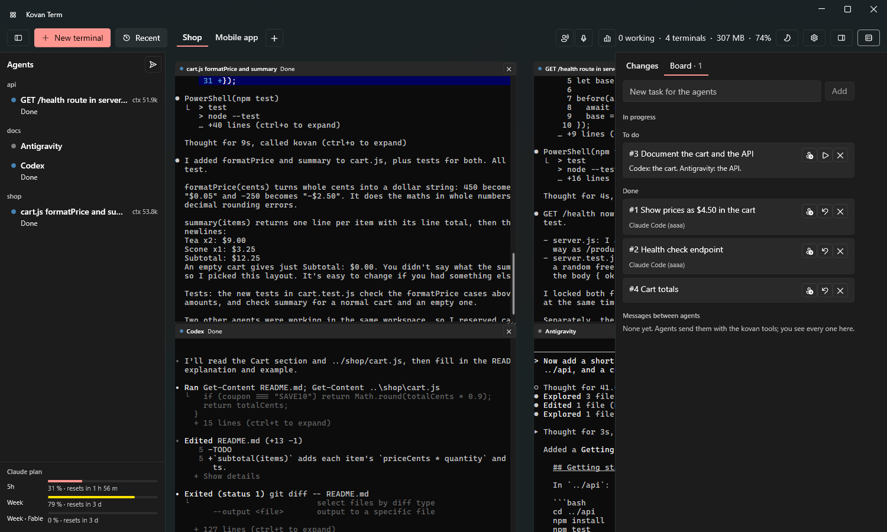
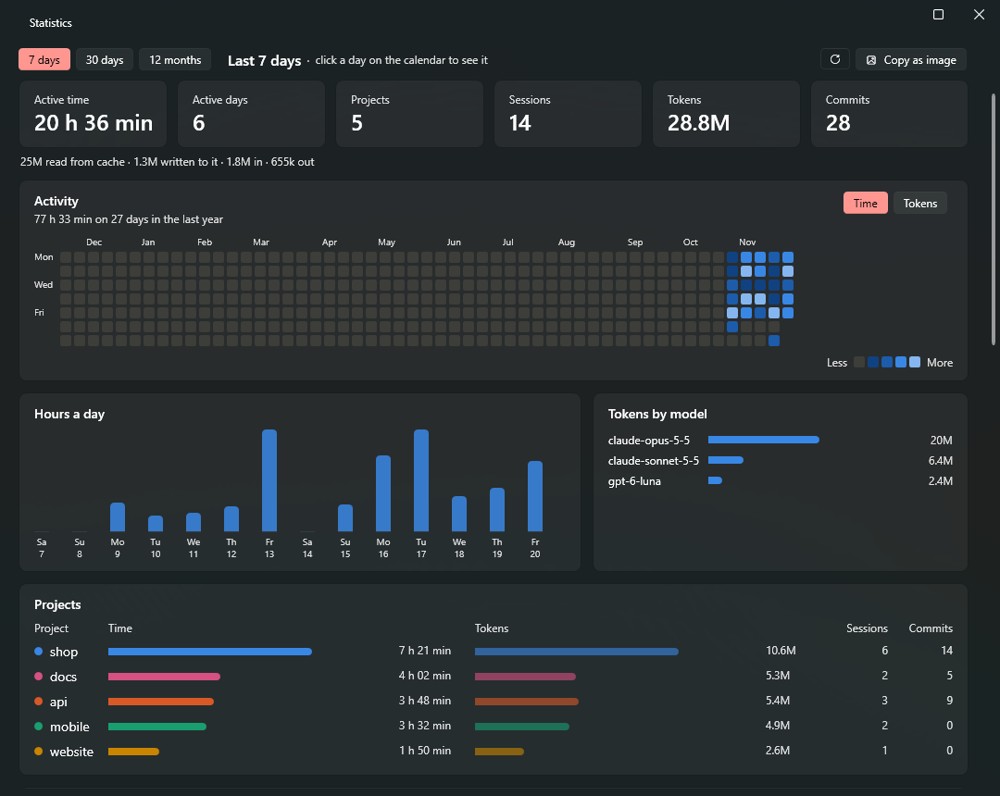
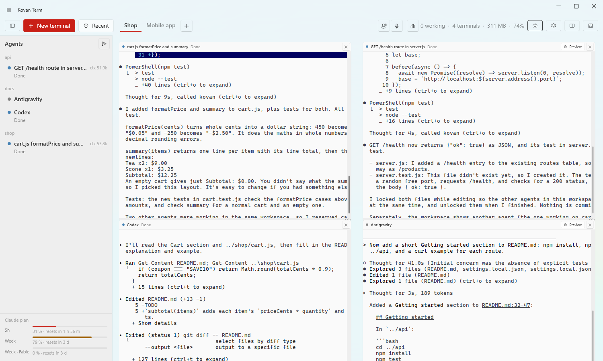

# Kovan Term

[English](README.md) · **Türkçe**

AI kodlama ajanlarını (Claude Code, Codex, Antigravity…) **sonsuz bir tuval** üzerinde, her biri
kendi **gerçek terminalinde**, yan yana çalıştıran hafif bir Windows uygulaması.

> ⚠️ Erken geliştirme aşamasında (v0.1). Yol haritası: [docs/roadmap.md](docs/roadmap.md) (İngilizce)



<sub>İki Claude Code ajanı, Codex ve Antigravity küçük bir proje üzerinde çalışıyor. İki Claude Code ajanı da onayını bekliyor: Allow ve Deny düğmeleri hem başlık çubuklarında hem Ajanlar panelinde.</sub>

## Neden?

Birden fazla ajanı terminal sekmeleri arasında yönetmek zor. Electron tabanlı tuval uygulamaları
(OpenCove, TermCanvas) bu sorunu çözüyor ama ağır. Kovan Term aynı fikri yerel .NET/WPF ve Windows
Terminal'in GPU hızlandırmalı terminal bileşeniyle, düşük kaynak tüketimiyle hedefliyor: 4 terminal
~190 MB RAM kullanıyor, WebView2 içinde xterm.js kullanan bir karşılığından ~3,5 kat az
([ölçüm](docs/decisions/0002-terminal-dependency-risk.md)).

## Özellikler

- Kaydırılıp yakınlaştırılabilen sonsuz tuval
- Tuval üzerinde sürüklenip boyutlandırılabilen gerçek terminaller
- Profiller: PowerShell, cmd, Claude Code (DeepSeek ya da yerel Ollama ile de), Codex, Antigravity, Cursor CLI, OpenCode, Qwen Code, Gemini CLI + kendi profillerin ([docs/profiles.md](docs/profiles.md))
- Çalışma dizini seçimi, tuvalde sağ tıkla "Burada yeni terminal"
- Tek bir istemi birden çok ajana aynı anda gönder; ör. aynı görevde Claude Code, Codex ve Antigravity'yi karşılaştır
- Başka bir uygulamadayken bir ajan seni beklediğinde ya da işini bitirdiğinde Windows bildirimi; tıklayınca ona gider
- İstersen başka yerde (VS Code, Windows Terminal) başlattığın Claude Code oturumları da Ajanlar panelinde; biri seni beklediğinde bildirim ([docs/outside-sessions.md](docs/outside-sessions.md))
- Dosyaları ya da ekran görüntülerini terminale sürükle, yolları ajana yazılsın
- İstatistikler: Claude Code ve Codex oturumlarından gün, proje ve modele göre süre ve token
- Sekmeler halinde birden çok çalışma alanı (ör. proje başına bir tane); gizli olanlardaki ajanlar çalışmayı sürdürür, seni beklediklerinde sekmede görünür
- Çalışma alanı otomatik kaydedilir ve açılışta geri gelir
- Dikte: konuşarak terminale yaz; ses bilgisayarında Whisper ile yazıya çevrilir (`Ctrl+Shift+Space`)
- Türkçe ve İngilizce sesli komutlar: "bekleyen ajana git", "Claude'a söyle testleri çalıştır" (`Ctrl+Shift+K`)
- Terminalde arama (`Ctrl+Shift+H`) ve geçmişi temizleme (`Ctrl+Shift+L`)
- Klavye kısayolları: terminaller arası geçiş, tümünü sığdır, yakınlaş ([docs/shortcuts.md](docs/shortcuts.md))
- "Fotoğraf modu" ile akıcı kaydırma ve zoom; ekran dışındaki terminaller uyur
- Windows 11 görünümü (Mica, Fluent kontroller); açık, koyu ya da Windows'a uyan tema; Dracula, Nord, Tokyo Night, Catppuccin gibi terminal renk şemaları

## Ekran görüntüleri

| | |
|---|---|
|  |  |
| **Değişiklikler**: seçili projede ajanların değiştirdikleri, fark (diff) olarak | **Pano**: ajanlara görevler; görevi kendileri alıp bitince tamamlandı olarak işaretliyorlar |
|  |  |
| **İstatistikler**: güne, projeye ve modele göre süre, token ve commit | Açık tema |

## Gereksinimler

- Windows 10 1903+ / Windows 11
- Kullanmak istediğin ajanların CLI'ları (ör. `claude`) `PATH`'te olmalı

## Kurulum

[Releases](https://github.com/MuhammedKaradas/kovan-term/releases) sayfasından
`KovanTerm-<sürüm>-win-x64.zip` dosyasını indir, bir klasöre aç ve `KovanTerm.exe`'yi çalıştır.
.NET kurulumu gerekmez. Exe henüz imzalı olmadığı için SmartScreen uyarısı çıkarsa
"Ek bilgi → Yine de çalıştır".

Kovan açılırken GitHub'a daha yeni bir sürüm olup olmadığını sorar, varsa bir düğme gösterir; senin yerine hiçbir
şey indirmez ya da kurmaz. Ayarlar → About bölümünden kapatılabilir.

Sürüm derlemeleri bir kez de çökme raporu ve kullanım istatistiği gönderilip gönderilmeyeceğini sorar; sen
onaylamadıkça ikisi de kapalıdır. Çökme raporunda yalnızca hata ve sürüm bilgileri vardır, yollar ve adlar silinir
(tüm alanlar [docs/crash-reports.md](docs/crash-reports.md)'de). Kullanım istatistiği ise sabit bir olay listesinden
günlük sayılardır, ör. "bir Codex düğümü açıldı" (hepsi [docs/usage-stats.md](docs/usage-stats.md)'de). Belgeler İngilizce.

## Kaynaktan çalıştırma

[.NET 10 SDK](https://dotnet.microsoft.com/download) gerekir.

```bash
git clone https://github.com/MuhammedKaradas/kovan-term.git
cd kovan-term
dotnet run --project src/KovanTerm -c Release
```

## Belgeler (İngilizce)

- [Mimari](docs/architecture.md)
- [Profiller](docs/profiles.md)
- [Klavye kısayolları](docs/shortcuts.md)
- [Yol haritası](docs/roadmap.md)
- [Mimari karar kayıtları](docs/decisions/)
- [Katkı kuralları](CONTRIBUTING.md): derleme, test ve değişiklik gönderme
- [Davranış kuralları](CODE_OF_CONDUCT.md)
- [Güvenlik politikası](SECURITY.md): açıkları gizli bildirin

## Teşekkürler

Kovan Term, tuval tabanlı ajan uygulamalarının hafif ve Windows'a özgü bir yorumu olarak başladı. Büyüdükçe
Onur Özcan'ın ([onurozcan](https://github.com/onurozcan)) **[omux](https://github.com/onurozcan/omux)**'undan çok şey öğrendi:
Claude Code ve Codex oturumlarını yan yana, her birini kendi dalında çalıştıran yerel bir macOS uygulaması (SwiftUI).
Açık kaynak olarak geliştirdiği için teşekkürler.

Mac'te doğrudan omux'u kullanabilirsiniz. Linux'ta İsmail Oktay Dak'ın ([radioheavy](https://github.com/radioheavy))
[omux for Linux](https://github.com/radioheavy/omux-linux)'u aynı uygulamayı oraya taşıyor (GTK 4, Rust). Kovan Term
bir port değil: Windows için kendi tuvali olan, omux'tan öğrenmiş ayrı bir uygulama.

Kovan Term'in birçok özelliği omux'un izinden gidiyor, bunlardan bazıları:
- Codex'in durumunu OSC 7501 bildirimlerinden okumak ve izin sorularını terminalin dışından cevaplamak;
- ajana not gönderilebilen Changes paneli;
- worktree'nin PR durumu ve kırık kontrollerin ajana gönderilmesi;
- bildirimler, durum ışığı ve bilgisayarı uyanık tutmak;
- terminallere konuşmalarının adını vermek ve terminale dosya bırakmak;
- süre ve token istatistikleri.

Kod Kovan Term'in kendisinin (C#/WPF), ama bunlardan birçoğunun nasıl çalıştığı omux'un kaynağından (MIT)
öğrenildi.

Kendi yolundan gittiği yerler:
- notlar, gruplar, web önizlemeleri ve çalışma alanları olan sonsuz bir tuval;
- dikte ve sesli komutlar;
- mesajlar, görev panosu ve dosya kilitleriyle bir ajan ağı;
- WSL içindeki ajanlar;
- tek istemi birden çok ajana göndermek.

## Lisans

[MIT](LICENSE)
